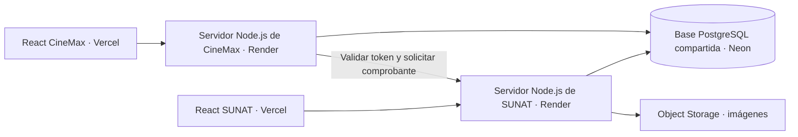

# Una base de datos para dos aplicaciones

## Qué se comparte

- Un proyecto de Neon y la misma base de datos; para el entorno entregado, `neondb` en la rama de producción del proyecto `solitary-scene-92117807`.
- `usuarios` identifica a la misma persona. `usuario_rol` asigna el rol de cada módulo: por ejemplo, administrador en `cine` y cliente en `sunat`.
- SUNAT administra `solicitudes_clave_sol`, `observaciones`, `integracion_tokens` y `consultas_atencion`.
- El compañero administra las ventas en `compras_entradas_cine` y sus tablas de funciones/asientos.
- `compras_entradas_cine.id_clave_sol` apunta a `solicitudes_clave_sol.id`; esa relación permite a SUNAT consultar y agrupar las ventas.

## Cómo conectará el compañero su backend

1. En Neon, copiar la conexión **pooled** de la misma base y rama. No crear otra base independiente.
2. Configurar esa conexión como `DATABASE_URL` en el servidor Render del compañero. No ponerla en React, GitHub, Postman, el navegador ni un mensaje público.
3. Coordinar migraciones antes de cambiar tablas compartidas. Conservar los IDs y no recrear tablas ni borrar datos.
4. Compartir los contratos de API y la URL pública del servidor SUNAT. No necesita recibir `JWT_SECRET` de SUNAT: puede validar un token llamando a su endpoint de validación.
5. Para una sesión compartida, el backend de CineMax consulta `GET /api/auth/validar` con el token de sesión emitido por SUNAT y utiliza el `id` y los roles devueltos. Debe validar la sesión antes de cada operación protegida; no basta con decodificar el JWT.
6. Para emitir un comprobante, utiliza el flujo de `INTEGRACION.md`. Un token de sesión y un token de integración tienen audiencias distintas; no son intercambiables.

SUNAT ya está preparada para ese consumo. Falta conectar y probar el servidor real de CineMax cuando el compañero entregue su URL y confirme que utiliza estas tablas y contratos. La prueba QA incluida emula su compra en la misma base, pero no sustituye la prueba con su aplicación.

La guía académica original muestra una SPA conjunta; esta entrega separa la implementación de cada integrante según tu instrucción más reciente y conserva una sola base y una identidad compartida. Para la sustentación final pueden integrar el frontend o enlazar ambos portales, según la indicación final del profesor.
